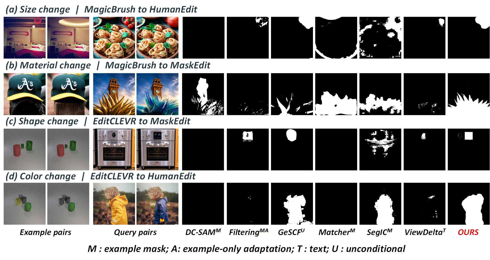

#Show Me the Change You Want：Visual Example-Guided Change Detection

**Visual Example-Guided Change Detection.** Give VECD two before-and-after image pairs: an example showing the change to look for and a query in which to find it. VECD returns a binary mask on the query. No text, example mask, or test-time training is needed.



*Figure 6. Cross-dataset queries from the paper. The example and query can show different objects.*

## Install

Run from the repository root with Python 3.10+. The paper used PyTorch 2.7.1 and torchvision 0.22.1 with CUDA 11.8. Install PyTorch for your platform, then:

```bash
python -m pip install -r requirements-tested.txt
python -m pip install -e .
python -m unittest discover -s tests
```

## Predict a mask

Place a trained VECD checkpoint at `weights/24201/model.safetensors`. The matching threshold is included in `configs/inference/seed24201.json`. CLIP ViT-B/16 and DINOv2-small load on first use; for local backbones pass `--clip-model PATH --dino-model PATH --offline`.

```bash
vecd infer --weights weights/24201/model.safetensors \
  --model-config configs/inference/seed24201.json \
  --example-before example_before.png --example-after example_after.png \
  --query-before query_before.png --query-after query_after.png --output outputs/demo
```

The four PNG paths are your inputs. The binary mask is `outputs/demo/prediction.png`; the unthresholded probabilities are in `outputs/demo/probability.npy`.

## Train VECD

Point the configs in `configs/` to your own records, labeled frames, and training and validation pairs. By default these lists are read from `protocols/` and image and annotation paths resolve against `data/prepared/`. Place the pretrained reader and CLIP value embeddings at `weights/initialization/model.safetensors` and `weights/initialization/prototypes.safetensors`.

```bash
vecd cache --manifest protocols/records.json --data-root data/prepared --cache cache/features
vecd train --config configs/static.json
vecd train --config configs/parent.json
for seed in 24201 24202 24203; do
  vecd train --config configs/mixed_${seed}.json
  vecd calibrate --weights outputs/mixed_${seed}/best.safetensors \
    --manifest protocols/records.json --episodes protocols/calibration_episodes.json \
    --data-root data/prepared --cache cache/features --output outputs/mixed_${seed}/calibrated.json
done
```

The static stage trains the reader on individual images. Paired training starts on EditCLEVR and continues on an equal mix of EditCLEVR and MagicBrush. Supply a separate source split for calibration.

## Evaluate on your data

Prepare `records.json` with `vecd prepare-annotated` (renders) or `vecd prepare-natural` (photos). In the same directory, supply an `episodes.json` list with one entry per request, for example `{"support":"example_id","query":"query_id","family":"color","mode":"set"}`. Both IDs must refer to records from different scenes. With these files and their image and mask paths rooted at `data/eval/`, run:

```bash
python tools/benchmark.py data/eval --data-root data/eval --seeds 24201 --cache-features
```
